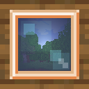
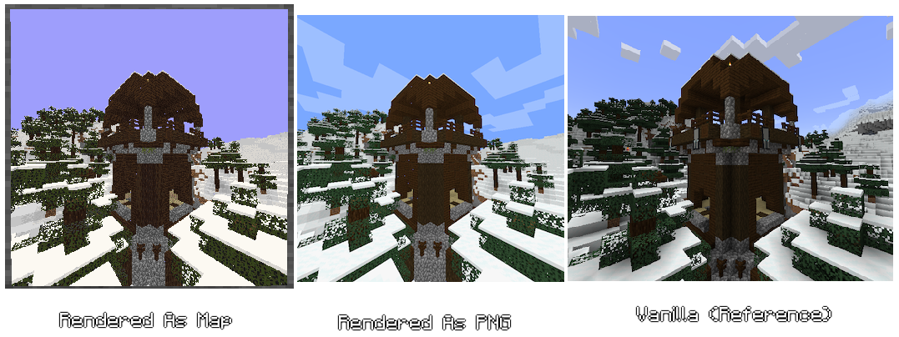

# 📷 Camera Obscura

**Versão selecionada no modpack:** `camera-obscura-fabric-2.1.1+26.3.jar`.



O Camera Obscura cria **fotos e gravações do mundo diretamente no servidor**, gerando imagens visíveis em mapas do Minecraft, sem exigir que todos os jogadores instalem o mod no cliente. A versão 2.1.x possui recursos mais amplos que as versões antigas.



## Como fotografar

Se uma câmera tiver sido disponibilizada pela administração, segure o item e utilize o **botão direito**. Após a captura, o mapa com a foto é colocado no inventário (ou pode cair no chão se o inventário estiver cheio).

Há também presets de câmera e de filmadora. A disponibilidade dos presets, receitas e permissões depende da configuração instalada no servidor.

## Comandos conhecidos

Os comandos abaixo são os documentados pelo autor para a linha atual do projeto. O nível de permissão base é **configurável** e, na configuração de referência, comandos podem exigir nível de operador.

| Comando | Finalidade |
| --- | --- |
| `/camera-obscura [escala]` | Captura um mapa da própria perspectiva. A escala vai até 3. |
| `/camera-obscura <entidade> <jogador> [escala]` | Captura a perspectiva de outra entidade e entrega o resultado ao jogador indicado. |
| `/camera-obscura save [entidade] [escala]` | Salva uma renderização como imagem PNG no servidor. |
| `/camera-obscura give <preset> [jogador]` | Entrega o item de câmera correspondente a um preset, se existir. |
| `/camera-obscura reload` | Recarrega a configuração; uso administrativo. |
| `/camera-obscura clear-cache` | Limpa recursos em cache; uso administrativo. |

Exemplo de criação de item, quando permitido:

```text
/camera-obscura give camera
```

O autor descreve presets como `camera`, `camcorder` e outros; **presets personalizados somente funcionam se estiverem definidos na configuração**.

## Gravações em vídeo

A câmera de vídeo pode gravar cenas para reprodução em itens/mapas compatíveis. Segundo o projeto, os arquivos das gravações ficam em `config/cameraobscura/camera_videos/`. É recomendável limitar armazenamento e acesso a gravações em servidores públicos.

## Configuração e arquivos no servidor

- Configuração: `config/cameraobscura/config.json`.
- Imagens PNG salvas: `config/cameraobscura/renders/`.
- Vídeos: `config/cameraobscura/camera_videos/`.
- Opções relevantes: distância de renderização, entidades, iluminação, campo de visão, antisserrilhamento, itens consumidos, permissões e execução de gravações.

Esses caminhos são da **documentação do projeto**; não foram inspecionados arquivos reais da instalação do New Empire.

## Atenção à versão

Este guia substitui informações antigas que afirmavam não haver renderização de entidades ou indicavam salvar PNGs na pasta `renders/` da raiz. O autor documenta atualmente a renderização de entidades e os caminhos acima. O comportamento exato da versão 2.1.1 deve ser confirmado no servidor.

**Links:** [Modrinth](https://modrinth.com/project/RlBTYKIp) · [Código-fonte](https://github.com/tomalbrc/camera-obscura) · [Catálogo de mods](/docs/explicacao-mods/catalogo).