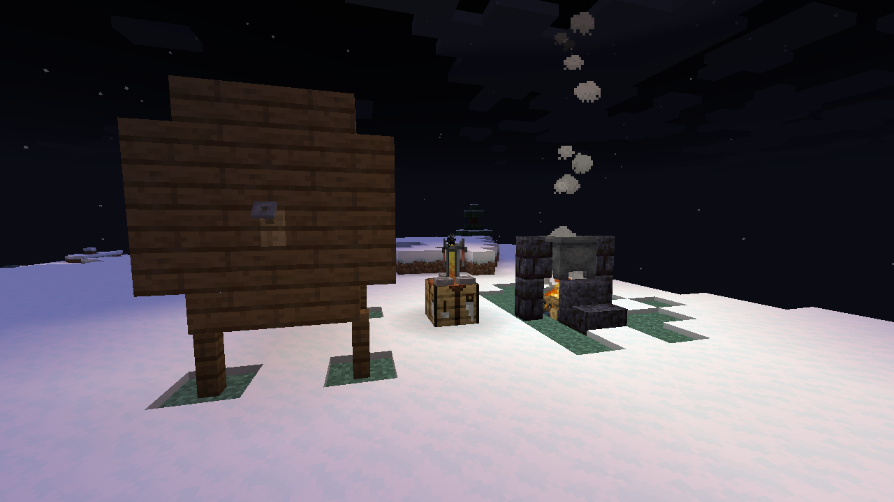
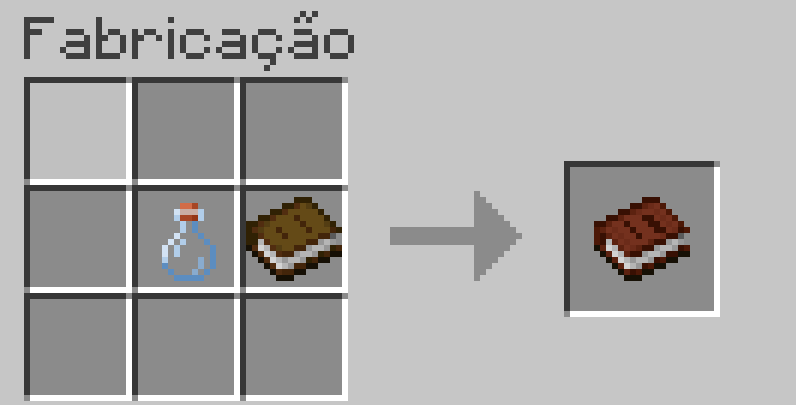
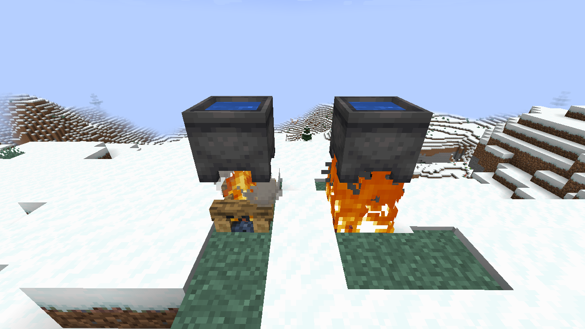
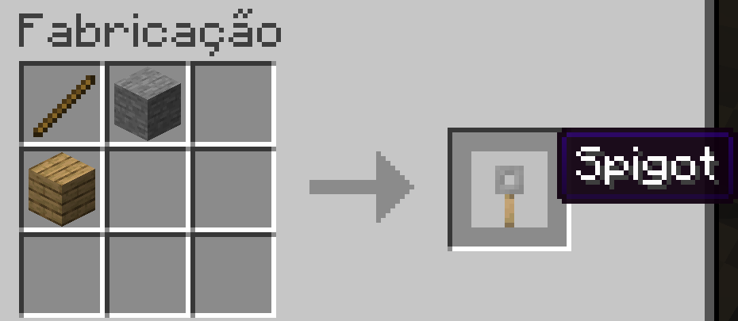
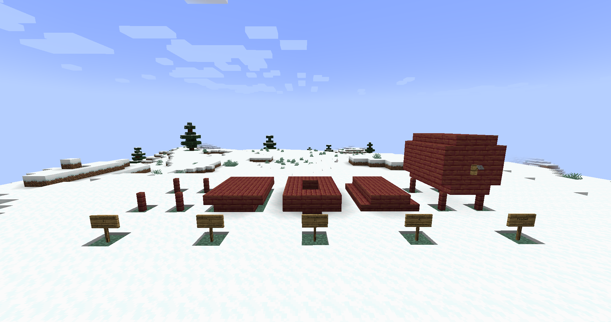

# 🍺 Cervejaria: Patbox's Brewery

**Versão selecionada no modpack:** `brewery-0.17.1+26.3.jar`.

O **Patbox's Brewery** permite criar bebidas alcoólicas e não alcoólicas usando caldeirões, fogueiras e barris especiais. As receitas adicionais podem ser fornecidas por datapacks, mas **o arquivo do modpack não permite confirmar se o New Empire usa receitas personalizadas**.

## 1. Consulte o livro de receitas

Fabrique o **Livro da Cervejaria** com **um livro** e **uma garrafa de vidro**. Nele você poderá consultar as receitas que o mod disponibiliza.

## 2. Prepare misturas no caldeirão

1. Coloque um **caldeirão com água** sobre uma fogueira.
2. Solte dentro dele os ingredientes da receita desejada.
3. Clique no caldeirão com um **graveto** para iniciar o preparo.
4. Acompanhe o tempo de cozimento exibido.
5. Use uma **garrafa de vidro vazia** para retirar a mistura ou bebida pronta no momento previsto na receita.

## 3. Construa um barril de envelhecimento

O barril especial é **uma estrutura construída no mundo**, não o barril comum de armazenamento.

Para a estrutura apresentada pelo autor, separe materiais de um mesmo tipo de madeira:

- **1 torneira** (fabricada com pedra, graveto e uma tábua);
- **4 cercas**;
- **16 escadas de madeira**;
- **20 tábuas de madeira**.

Posicione os materiais de acordo com a estrutura a seguir. A orientação das escadas não importa; **instale a torneira por último**.

## 4. Envelheça a bebida

Clique no barril construído e guarde as misturas nele. Algumas bebidas precisam de envelhecimento; o tipo de madeira e o tempo podem influenciar sua qualidade. Retire os itens quando a receita atingir o resultado desejado.

## Receitas extras

O projeto aceita datapacks de bebidas, mas estes são **opcionais**. Exemplos de pacotes externos são [Cabbage Substances](https://modrinth.com/datapack/cabbage-substances), [Mainstay Recipe Book](https://modrinth.com/datapack/mainstay-recipe-book) e [To the Baikal](https://modrinth.com/datapack/to-the-baikal). **Não são apresentados aqui como instalados no servidor.**

**Links:** [Modrinth](https://modrinth.com/project/nr7cSJlY) · [GitHub](https://github.com/Patbox/brewery) · [Catálogo](/docs/explicacao-mods/catalogo).