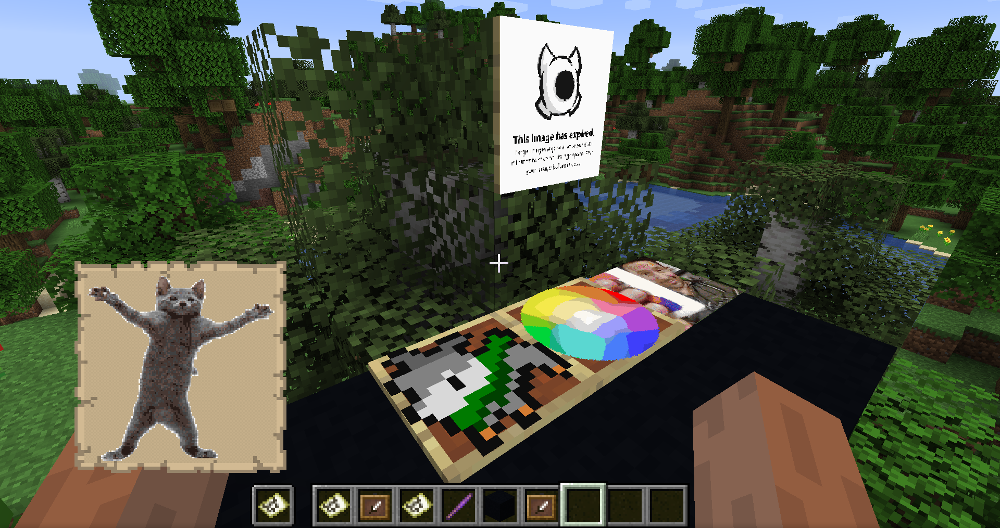
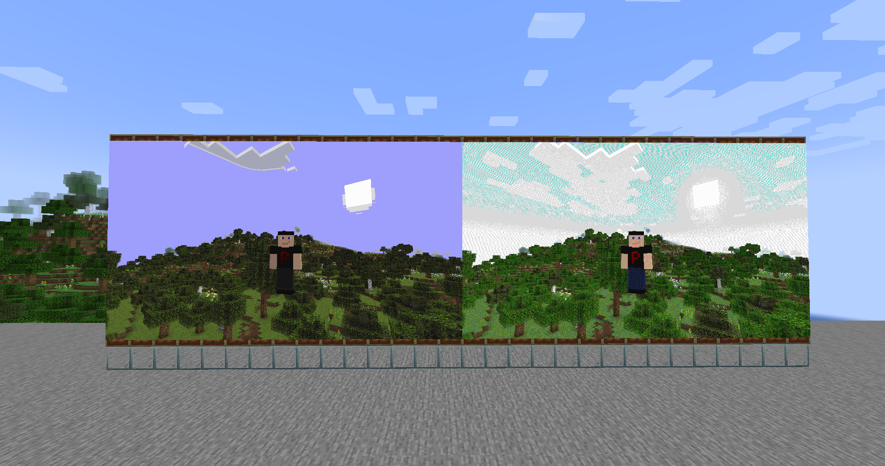

# 🖼️ Image2Map

**Versão selecionada no modpack:** `image2map-0.15.0+26.3.jar`.

O **Image2Map** transforma imagens em um ou vários mapas do Minecraft, permitindo criar quadros, cartazes e painéis decorativos dentro do jogo.

## Comandos

Os comandos apresentados pelo autor são:

| Comando | Ação |
| --- | --- |
| `/image2map create <LARGURA> <ALTURA> <dither/none> <URL>` | Cria mapas na dimensão informada em pixels. |
| `/image2map create <dither/none> <URL>` | Cria um mapa a partir de uma imagem. |
| `/image2map preview <URL>` | Inicia um modo de pré-visualização antes de salvar. |

**Exemplo de uso:** selecione uma URL de imagem que possa ser acessada pelo servidor e utilize `/image2map preview <URL>`, substituindo `<URL>` pelo endereço real.

### Durante a pré-visualização

- `/dither <dither/none>`: altera o modo de processamento de cores.
- `/size`: consulta o tamanho atual.
- `/size <LARGURA> <ALTURA>`: muda as dimensões, em pixels.
- `/grid`: mostra ou oculta a grade dos mapas.
- `/save`: confirma e salva os itens.
- `/exit`: fecha sem salvar.

## Dimensões e mapas múltiplos

Cada mapa comum possui **128 × 128 pixels**. Para criar painéis maiores, o mod pode gerar um conjunto de mapas. Segundo a documentação do projeto, ao usar o pacote de mapas no **canto superior esquerdo** de um conjunto de molduras, os mapas podem ser distribuídos automaticamente.

## O que é dithering?

É uma técnica de distribuição de pixels para simular gradientes e reduzir faixas abruptas de cor. Em mapas, pode representar melhor algumas imagens com a paleta limitada do Minecraft. Compare os modos `dither` e `none` na prévia antes de salvar.

## Segurança e permissões

O Image2Map obtém imagens por URL. Evite links privados, arquivos com dados pessoais ou recursos externos não confiáveis. A administração deve revisar **permissões, limites de uso e política de URLs** antes de liberar o recurso publicamente.

Os comandos acima representam as funções documentadas pelo autor, **não uma garantia de acesso** para cada jogador do New Empire.

**Links:** [Modrinth](https://modrinth.com/project/13RpG7dA) · [GitHub](https://github.com/Patbox/Image2Map) · [Catálogo](/docs/explicacao-mods/catalogo).